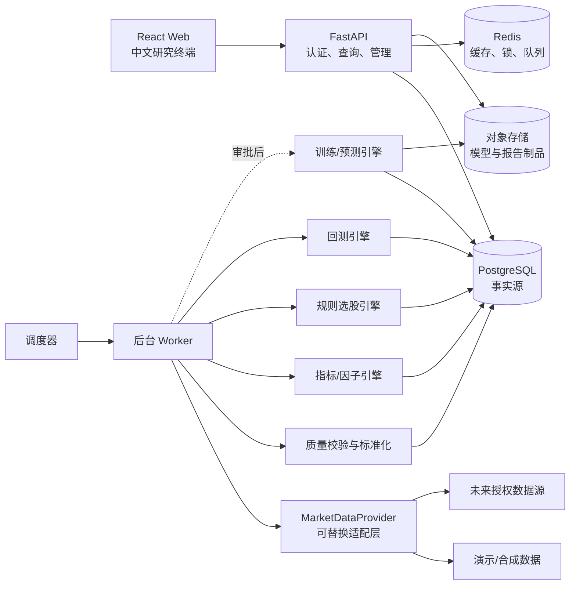
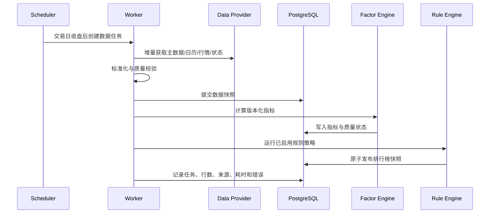

# A 股 AI 智能选股平台总体架构

> 版本：0.1（内部研究设计）  
> 日期：2026-10-23  
> 状态：设计稿，不授权公开发布、模型训练、证券推荐、支付或实盘交易。

## 1. 架构目标与边界

平台先交付可验证的 A 股日频研究 MVP：统一采集与追溯行情，计算技术指标，以透明规则生成每日候选榜，并用符合 A 股约束的回测验证规则。1、3、5 个交易日 LightGBM 模型仅完成接口与治理设计，未通过滚动样本外验证和合规审批前不向用户展示“上涨概率”。

明确不包含：券商连接、自动下单、收益承诺、个性化投资建议、支付系统、未经授权数据的公开展示或再分发。

## 2. 技术选型结论

保留用户指定的主栈，并作三项补充：

| 层 | 选择 | 决策理由 |
|---|---|---|
| 前端 | React + TypeScript + Vite + Ant Design + ECharts | 类型安全、组件完整，适合桌面金融终端；响应式布局为手机预留 |
| API | Python 3.12 + FastAPI + Pydantic | 与 pandas/LightGBM 生态一致，OpenAPI 契约清晰 |
| 关系数据库 | PostgreSQL 16 | 支持约束、事务、JSONB、分区和审计；作为唯一事实源 |
| 缓存/协调 | Redis 7 | 热点查询缓存、分布式锁和任务队列；不得保存唯一事实 |
| 后台任务 | Celery（MVP） | 与 Redis/FastAPI 成熟集成，适合采集、指标、筛选、回测；后期任务量大再评估 Temporal/Airflow |
| ORM/迁移 | SQLAlchemy 2 + Alembic | 明确事务边界和可版本化数据库变更 |
| 数据计算 | pandas + NumPy；指标自主实现并以 TA-Lib 结果交叉验证 | 减少 C 扩展部署阻力，同时保留数值正确性对照 |
| 模型 | LightGBM + scikit-learn 校准器 | 表格因子基线强、可解释、训练成本可控 |
| 模型制品 | 对象存储 + PostgreSQL 元数据 | 模型二进制不进入数据库；哈希与元数据可追溯 |
| 容器 | Docker Compose（开发/单机测试） | 本地、Codespaces 和小规模测试环境一致 |
| CI | GitHub Actions | lint、类型检查、单测、迁移检查、镜像构建和安全扫描 |

不在 MVP 引入 Kubernetes、Kafka、微服务拆分、特征平台或向量数据库。当前吞吐量可由模块化单体 API + 独立 Worker 满足；这些组件会增加成本和运维面。

## 3. 逻辑架构



部署上保持一个仓库、多个进程：`web` 静态站、`api`、`worker`、`scheduler`、PostgreSQL、Redis。模块之间先使用 Python 包边界和数据库契约，不急于拆成网络微服务。

## 4. 建议仓库结构

```text
ashare-ai-platform/
├─ .devcontainer/
│  ├─ devcontainer.json
│  └─ Dockerfile
├─ .github/workflows/
│  ├─ ci.yml
│  ├─ security.yml
│  └─ scheduled-research.yml       # 默认关闭真实数据任务
├─ apps/
│  ├─ web/                         # React/Vite/Ant Design/ECharts
│  └─ api/                         # FastAPI 启动、路由、依赖注入
├─ packages/
│  └─ api-client/                  # OpenAPI 生成的 TS 客户端
├─ services/
│  ├─ market_data/                 # Provider、标准化、质量规则
│  ├─ factors/                     # 指标注册表、增量计算
│  ├─ screening/                   # 规则 DSL、评分、快照
│  ├─ modeling/                    # 数据集、训练、校准、推理（门禁）
│  └─ backtesting/                 # 订单、成交、成本、指标
├─ shared/                         # 配置、DB、日志、审计、领域类型
├─ migrations/                    # Alembic
├─ tests/
│  ├─ unit/
│  ├─ integration/
│  ├─ contract/
│  └─ fixtures/demo/
├─ docs/
├─ infra/
│  ├─ compose/
│  └─ deployment/
├─ scripts/                        # 幂等运维脚本，不存密钥
├─ .env.example
├─ compose.yaml
├─ pyproject.toml
├─ uv.lock
├─ package.json
├─ pnpm-lock.yaml
└─ README.md
```

## 5. 核心模块

### 5.1 行情数据中心

定义稳定接口 `MarketDataProvider`：

- `get_instruments(as_of)`：证券主数据和点时状态。
- `get_trade_calendar(exchange, start, end)`：交易日历。
- `get_daily_bars(symbols, start, end, adjustment)`：日 K。
- `get_corporate_actions(...)`：分红、送转、拆并等公司行动。
- `get_trading_status(...)`：停牌、ST、上市、退市、涨跌停规则所需状态。
- `health()` 与 `capabilities()`：来源健康度、字段覆盖、许可范围。

采集分为 raw、standardized、published 三个状态。原始响应可按数据合同决定是否保存；标准表必须带来源、供应商时间、抓取时间、版本和质量标志。发布前执行主键重复、OHLC 逻辑、负值、缺口、异常跳变、跨源抽样对账。严重错误阻断当日筛选，不能静默填充。

演示数据 Provider 必须使用合成或明确允许再分发的数据，并在 UI 显著标记“演示数据”。真实 Provider 按合同插件化，不把供应商字段泄漏到上层领域模型。

### 5.2 指标与因子引擎

`FactorDefinition` 包含名称、版本、输入字段、窗口、参数、最小历史长度、输出类型和实现哈希。MVP 指标：MA、EMA、MACD、RSI、成交量变化率、量比、历史波动率、ATR、趋势斜率/强度、相对基准强弱。

计算原则：

- 只读取决策时点以前的数据；窗口显式声明。
- 每次计算绑定 `data_snapshot_id` 与 `factor_set_version`。
- 增量计算时向前加载最大窗口 + 缓冲，但仅覆盖受影响日期。
- NaN、停牌连续条、上市不足窗口不做隐式补齐，保存质量状态。
- 固定样例与另一可信实现做数值容差对照。

### 5.3 规则选股引擎

规则使用受限 JSON DSL，不允许执行任意 Python/SQL。条件只引用已发布因子，例如趋势、动量、量能、波动和流动性；每项输出 0–100 子分及中文原因。总分、过滤原因和规则版本全部持久化。

每日流水线：数据就绪检查 → 可交易股票池快照 → 因子就绪检查 → 硬过滤（停牌、上市天数、流动性等）→ 规则评分 → 排名 → 结果快照发布。发布幂等键为 `(strategy_version_id, trade_date, universe_snapshot_id)`。

MVP 页面称“规则评分/研究候选”，不称上涨概率、买入建议或目标价。

### 5.4 AI 预测引擎（仅设计）

为每个期限建立独立二分类器，避免一个模型输出含义混乱：

- 决策时点：交易日 `t` 收盘数据完成且通过质量检查之后。
- 标签：`y_h = 1[close_adj(t+h) / close_adj(t) - 1 > threshold_h]`，`h ∈ {1,3,5}`；阈值、价格口径和不可交易样本政策必须版本化。
- 实际可交易评估：信号最早从 `t+1` 的第一个可交易价格执行；模型标签与策略收益是两个不同对象，均需报告。
- 特征：只取 `available_at <= decision_time` 的点时特征；横截面变换只在当日可见股票池内完成。
- 切分：按时间滚动；训练、校准、测试连续且互不重叠；至少 purge 最大标签期限，并设置 embargo；所有预处理只在训练窗拟合。
- 校准：只使用独立校准窗，比较 Platt/Isotonic；报告 Brier、log loss、ECE、校准图、AUC/PR-AUC、分组收益与覆盖率。
- 版本：代码 commit、数据快照、特征集、股票池、标签、切分、LightGBM 参数、随机种子、依赖锁、制品 SHA-256、审批状态。

模型生命周期：`draft → validated → approved_internal → approved_public → retired`。只有 `approved_public` 且合规开关开启时，公网 API 才能返回概率；MVP 固定关闭。LLM 股票诊断未来只对结构化事实做解释和引用，不生成/修改数值预测。

### 5.5 回测系统

采用事件驱动的日频回测：信号 → 目标组合 → 订单 → 可成交性校验 → 成交 → 费用 → 持仓与净值。规则和未来模型共享同一回测路径。

必须处理：T+1 卖出限制、历史板块/ST 涨跌幅规则、停牌、涨跌停不可成交、成交量约束、上市/退市、公司行动、佣金最低收费、印花税历史版本、过户费、滑点和基准指数。执行价格、信号时间和复权口径分开记录，禁止用复权价虚拟成交。

输出总收益、年化收益/波动、最大回撤、Sharpe（注明无风险利率）、胜率、盈亏比、换手、成本占比、超额收益、信息比率，以及逐日净值、成交和不可成交原因。所有结果绑定数据与策略版本。

### 5.6 用户与管理

MVP 可用内部账号或关闭注册。架构预留：邮箱/手机号身份、用户状态、角色 RBAC、会话/刷新令牌、Watchlist、会员 entitlement、审计日志。支付不实现，会员权限只定义能力键，例如 `backtest.create`，不把套餐名硬编码进业务。

管理员后台首批仅含：数据任务状态、质量告警、策略版本查看、回测任务、用户禁用与审计。高风险动作要求二次确认并记录操作者、原因、前后值。

## 6. 端到端每日流程



失败策略：任一步失败则保留上一次成功发布结果，并在 API 标明 `stale=true` 与最后成功时间；不发布半完成批次。任务按唯一键幂等，重试使用指数退避，并给数据源设并发/速率限制。

## 7. 非功能要求

- **正确性**：金额/价格使用 `NUMERIC`；时间统一 UTC 保存、界面按 Asia/Shanghai 展示；交易日使用 `DATE`。
- **性能**：股票搜索 p95 < 200 ms，排行榜/K 线 p95 < 500 ms（缓存命中条件下）；回测异步。
- **可用性**：内部 MVP 单区部署，数据库每日备份并做恢复演练；任务失败可重跑。
- **安全**：最小权限、TLS、Argon2id、短期访问令牌、HttpOnly 刷新 Cookie、CSRF 防护、限流、审计、密钥托管。
- **可观测性**：结构化日志、request/task ID、指标、错误追踪；禁止记录 token、密码、完整授权数据响应。
- **可访问性与适配**：桌面优先，关键表格在手机切换卡片/横向滚动；颜色不是涨跌的唯一编码。

## 8. ADR 级关键决定

1. 模块化单体优先，后台任务进程分离；有明确独立扩容或安全边界后再拆服务。
2. PostgreSQL 是唯一事实源，Redis 可随时清空重建。
3. 数据/因子/策略/模型/成本全部版本化，任何结果必须能反查输入快照。
4. 规则结果先于 ML 概率上线；概率展示由技术验证与合规审批双门禁控制。
5. Qlib 可在离线研究 PoC 中评估，但核心数据模型、API 和回测契约不依赖 Qlib。
6. 内部研发可用演示数据；任何真实数据源上线前必须完成许可矩阵审批。

## 9. 验收门槛

- 五类追溯链完整：页面结果 → 运行 → 策略/模型版本 → 因子集 → 数据快照/来源。
- 同一快照和版本重复运行结果一致；任务重跑不产生重复发布。
- 固定回测样例覆盖 T+1、停牌、涨跌停、费用和退市边界。
- 任何数据质量阻断均可见且不会悄悄产出新排行榜。
- MVP API 不返回模型概率字段，不存在下单或支付端点。
- 公开发布前完成数据授权、安全、隐私和证券业务合规评审。
