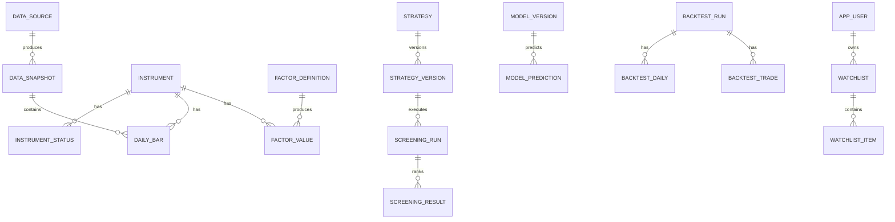

# A 股 AI 智能选股平台数据库设计

> PostgreSQL 16；逻辑设计 v0.1。Redis 只用于缓存、锁和队列，不承载事实数据。

## 1. 设计约定

- 主键默认 `uuid`；高容量时序表使用 `bigint generated always as identity`，并保留业务唯一键。
- 交易日期用 `date`，事件时间用 `timestamptz`（UTC），价格/金额用 `numeric(20,6)`，比率用 `numeric(18,10)`。
- 股票内部标识统一为 `instrument_id`，展示代码不充当外键，避免代码/市场规则变化。
- 高容量表按 `trade_date` 月度或年度 RANGE 分区；MVP 数据较小时可先不物理分区，但迁移需保留能力。
- 所有批量产物先写 staging/运行 ID，校验后在事务内发布，避免半批数据。
- JSONB 只用于参数、证据和扩展元数据；核心可查询字段必须结构化。

## 2. 关系概览

## 3. 市场与数据治理表

### `data_source`

| 列 | 类型 | 约束/说明 |
|---|---|---|
| id | uuid | PK |
| code | varchar(50) | UNIQUE NOT NULL，如 `demo_v1` |
| name | varchar(120) | NOT NULL |
| source_type | varchar(30) | CHECK: demo/free/licensed |
| license_scope | jsonb | 允许存储、展示、派生、环境范围 |
| enabled | boolean | NOT NULL DEFAULT false |
| config_ref | varchar(200) | 仅密钥引用，不存 secret |
| created_at/updated_at | timestamptz | NOT NULL |

### `data_snapshot`

`id uuid PK`，`data_source_id FK`，`dataset_type varchar(40)`，`as_of_at timestamptz`，`fetched_at timestamptz`，`published_at timestamptz NULL`，`status varchar(20)`，`row_count bigint`，`content_hash char(64)`，`schema_version varchar(40)`，`quality_summary jsonb`，`update_job_id uuid NULL`。唯一约束 `(data_source_id, dataset_type, as_of_at, content_hash)`；索引 `(dataset_type, status, as_of_at DESC)`。

### `instrument`

| 列 | 类型 | 约束/说明 |
|---|---|---|
| id | uuid | PK |
| exchange | varchar(10) | NOT NULL，SSE/SZSE/BSE |
| symbol | varchar(16) | NOT NULL |
| name_cn | varchar(80) | NOT NULL |
| pinyin/abbr | varchar(160)/varchar(40) | 搜索辅助 |
| board | varchar(30) | 主板/科创板/创业板/北交所 |
| instrument_type | varchar(20) | MVP 仅 stock/index |
| list_date/delist_date | date | delist 可空 |
| currency | char(3) | DEFAULT CNY |
| lot_size | integer | CHECK > 0 |
| created_at/updated_at | timestamptz | NOT NULL |

唯一约束 `(exchange, symbol)`；索引 `symbol`、`name_cn`，并用 `pg_trgm` GIN 索引 `name_cn/pinyin` 支持模糊搜索。

### `instrument_status`

`id bigint PK`，`instrument_id FK`，`trade_date date`，`is_listed/is_st/is_suspended/is_tradeable boolean`，`limit_up_pct/limit_down_pct numeric(8,6)`，`reason varchar(255)`，`data_snapshot_id FK`，`available_at timestamptz`。唯一 `(instrument_id, trade_date, data_snapshot_id)`；索引 `(trade_date, is_tradeable)`。

### `trade_calendar`

`exchange varchar(10)`，`calendar_date date`，`is_trade_day boolean`，`previous_trade_date/next_trade_date date`，`session_open/session_close time`，`data_snapshot_id FK`。主键 `(exchange, calendar_date)`；索引 `(exchange, is_trade_day, calendar_date)`。

### `daily_bar`

`id bigint PK`，`instrument_id FK`，`trade_date date`，`open/high/low/close numeric(20,6)`，`volume numeric(24,4)`，`amount numeric(24,4)`，`turnover_rate numeric(18,10) NULL`，`prev_close numeric(20,6)`，`adjustment_type varchar(10)`，`adjust_factor numeric(24,12)`，`data_snapshot_id FK`，`available_at timestamptz`，`quality_status varchar(20)`。

唯一 `(instrument_id, trade_date, adjustment_type, data_snapshot_id)`；常用索引 `(instrument_id, trade_date DESC)`、`(trade_date, instrument_id)`。按 `trade_date` 分区。CHECK：价格非负、`high >= greatest(open, close, low)`、`low <= least(open, close, high)`、量额非负。

建议 raw 与 adjusted 行情不要混写为不可解释的单值。MVP 可保存原始 OHLC + adjustment factor，由查询/因子任务生成确定口径；若物化复权 K 线，必须以 `adjustment_type` 和快照唯一。

### `corporate_action`

`id uuid PK`，`instrument_id FK`，`action_type`，`announcement_at`，`ex_date`，`record_date`，`cash_amount`，`share_ratio`，`data_snapshot_id FK`，`available_at`。唯一键由供应商事件 ID 或 `(instrument_id, action_type, ex_date, announcement_at)` 保证。

### `data_update_job`

`id uuid PK`，`job_type`，`source_id FK`，`requested_by`，`scheduled_for`，`started_at/finished_at`，`status`，`attempt`，`idempotency_key varchar(160) UNIQUE`，`rows_read/inserted/updated/rejected bigint`，`error_code/error_message`，`quality_report jsonb`，`correlation_id uuid`。索引 `(job_type, status, created_at DESC)`。

### `data_quality_issue`

`id uuid PK`，`update_job_id FK`，`snapshot_id FK NULL`，`instrument_id FK NULL`，`trade_date date NULL`，`rule_code`，`severity CHECK(info/warn/blocker)`，`field_name`，`observed_value jsonb`，`message`，`resolution_status`，`resolved_by FK app_user NULL`，`resolved_at`。索引 `(severity, resolution_status, created_at DESC)`。

## 4. 因子与筛选表

### `factor_definition`

`id uuid PK`，`code varchar(80)`，`version integer`，`name_cn`，`description`，`category`，`input_spec jsonb`，`parameters jsonb`，`lookback_days integer`，`output_type`，`implementation_hash char(64)`，`created_at`。唯一 `(code, version)`。

### `factor_set`

`id uuid PK`，`code`，`version`，`definition_refs jsonb`（有序的 factor ID/版本），`content_hash char(64) UNIQUE`，`status`，`created_at`。模型和策略引用因子集而非“当前因子”。

### `factor_value`

`id bigint PK`，`instrument_id FK`，`trade_date date`，`factor_definition_id FK`，`value numeric(24,12) NULL`，`value_text varchar(50) NULL`，`quality_status`，`available_at`，`data_snapshot_id FK`，`factor_run_id uuid`。唯一 `(instrument_id, trade_date, factor_definition_id, data_snapshot_id)`；索引 `(factor_definition_id, trade_date, value)` 和 `(instrument_id, trade_date)`；按日期分区。

### `strategy` / `strategy_version`

`strategy`: `id uuid PK`，`code UNIQUE`，`name_cn`，`description`，`strategy_type CHECK(rule/model)`，`owner_user_id NULL`，`created_at`。

`strategy_version`: `id uuid PK`，`strategy_id FK`，`version integer`，`status CHECK(draft/active/retired)`，`rule_definition jsonb`，`factor_set_id FK`，`universe_definition jsonb`，`score_definition jsonb`，`effective_from/to`，`code_commit char(40)`，`content_hash char(64)`，`approved_by/approved_at`。唯一 `(strategy_id, version)`，且每个策略最多一个 active（部分唯一索引）。

### `universe_snapshot`

`id uuid PK`，`trade_date`，`definition_hash`，`data_snapshot_id FK`，`instrument_count`，`members_uri` 或配套明细表，`created_at`。唯一 `(trade_date, definition_hash, data_snapshot_id)`。若使用明细表 `universe_member(snapshot_id, instrument_id, inclusion_reason)`，复合 PK。

### `screening_run`

`id uuid PK`，`strategy_version_id FK`，`trade_date`，`universe_snapshot_id FK`，`factor_set_id FK`，`data_snapshot_id FK`，`status`，`started_at/finished_at/published_at`，`candidate_count`，`code_commit`，`parameters jsonb`，`idempotency_key UNIQUE`，`error_message`。唯一的发布运行可用部分唯一索引 `(strategy_version_id, trade_date) WHERE status='published'`。

### `screening_result`

`screening_run_id FK`，`instrument_id FK`，`rank integer CHECK > 0`，`total_score numeric(8,4)`，`subscores jsonb`，`matched_rules jsonb`，`excluded boolean`，`exclusion_reasons jsonb`，`data_as_of timestamptz`。主键 `(screening_run_id, instrument_id)`；唯一 `(screening_run_id, rank)`（仅非 excluded 可用部分索引）；索引 `(instrument_id, data_as_of DESC)`。

## 5. 模型与预测表

### `model_version`

`id uuid PK`，`model_code`，`version`，`horizon_days CHECK IN (1,3,5)`，`algorithm`，`status CHECK(draft/validated/approved_internal/approved_public/retired)`，`feature_set_id FK`，`label_definition jsonb`，`universe_definition jsonb`，`train_start/end`，`calibration_start/end`，`test_start/end`，`split_definition jsonb`，`hyperparameters jsonb`，`metrics jsonb`，`data_snapshot_id FK`，`code_commit char(40)`，`dependency_hash char(64)`，`artifact_uri`，`artifact_sha256 char(64)`，`model_card_uri`，`approved_by/approved_at`，`created_at`。唯一 `(model_code, version)`；不允许同一 code/version 改写制品。

### `model_prediction`

`id bigint PK`，`model_version_id FK`，`instrument_id FK`，`decision_date date`，`decision_at timestamptz`，`horizon_days`，`raw_score numeric(18,10)`，`calibrated_probability numeric(10,9) NULL CHECK 0..1`，`predicted_class boolean NULL`，`feature_snapshot_id FK`，`created_at`，`visibility CHECK(internal/public/blocked)`。唯一 `(model_version_id, instrument_id, decision_date)`；索引 `(decision_date, horizon_days, raw_score DESC)`。

数据库允许保存内部验证概率，但 API 由模型状态与 visibility 双重过滤。MVP 不创建公开概率响应。

## 6. 回测表

### `backtest_run`

`id uuid PK`，`strategy_version_id FK NULL`，`model_version_id FK NULL`，`requested_by FK app_user NULL`，`status`，`start_date/end_date`，`benchmark_instrument_id FK`，`initial_cash numeric(20,2)`，`parameters jsonb`，`cost_model_version`，`execution_model_version`，`data_snapshot_id FK`，`factor_set_id FK`，`code_commit`，`idempotency_key UNIQUE`，`metrics jsonb`，`result_hash`，`started_at/finished_at`，`error_message`。CHECK：策略或模型恰有一个来源。

### `backtest_daily`

`backtest_run_id FK`，`trade_date`，`nav`，`cash`，`market_value`，`daily_return`，`benchmark_return`，`drawdown`，`turnover`，`cost`。主键 `(backtest_run_id, trade_date)`。

### `backtest_order` / `backtest_trade`

订单记录 `signal_at`、`submit_date`、方向、数量、参考价、状态和拒绝原因；成交记录实际日期、原始成交价、数量、佣金、税费、过户费、滑点、总成本、`settle_date`。索引 `(backtest_run_id, instrument_id, trade_date)`。不可成交必须作为订单结果保存，而不是删除。

### `backtest_position`

主键 `(backtest_run_id, trade_date, instrument_id)`；保存数量、可卖数量（T+1）、成本、原始收盘价、市值和未实现收益。

## 7. 用户、权限与审计表

### `app_user`

`id uuid PK`，`email citext UNIQUE`，`phone varchar(32) UNIQUE NULL`，`password_hash`，`display_name`，`status`，`email_verified_at`，`last_login_at`，`created_at/updated_at`。密码 Argon2id；不保存明文或可逆密码。

### `role` / `permission` / `user_role` / `role_permission`

标准 RBAC 多对多表。权限使用稳定键：`screening.read`、`backtest.create`、`data_job.manage`。管理员权限不由前端判断。

### `watchlist` / `watchlist_item`

`watchlist(id PK, user_id FK, name, is_default, created_at)`，唯一 `(user_id, name)`；`watchlist_item(watchlist_id, instrument_id, note, created_at)` 复合 PK，索引 `(instrument_id, created_at)`。

### `entitlement`

仅预留：`id`、`user_id`、`capability_code`、`valid_from/to`、`source`、`status`、`metadata`。MVP 不接支付、不生成收费 entitlement。

### `audit_log`

`id bigint PK`，`occurred_at`，`actor_user_id NULL`，`action`，`resource_type/resource_id`，`request_id`，`ip_hash`，`before_data/after_data jsonb`，`reason`。按时间分区；追加写，限制管理员直接修改。

## 8. 缓存键与失效

- `instrument:search:{query_hash}` TTL 5–30 分钟。
- `bars:{instrument}:{range}:{snapshot}` TTL 5 分钟到 1 小时。
- `screening:latest:{strategy}` TTL 5 分钟，发布新 run 后主动失效。
- `job-lock:{job_type}:{trade_date}` 使用有 TTL 的分布式锁。
- 缓存值带 `schema_version` 和事实表版本；Redis 丢失不得影响正确性。

## 9. 数据保留、备份与隐私

- 研究运行与发布结果默认长期保留以供复现；raw 数据按授权合同设置 TTL。
- PostgreSQL 每日备份，生产启用 PITR；备份加密并定期做恢复演练。
- 模型/报告对象启用版本、哈希和生命周期策略。
- 用户删除流程对身份数据匿名化；研究与审计保留期由合规政策确定。
- 开发/测试仅使用演示数据和伪用户，不复制生产数据库。

## 10. 迁移与验收

Alembic 迁移必须可从空库升级；CI 检查单一 head、向前迁移和关键约束。首批数据库测试至少覆盖：业务唯一键、OHLC CHECK、重复任务幂等、单一发布 run、模型公开状态门禁、T+1 可卖数量、用户级 Watchlist 隔离。
